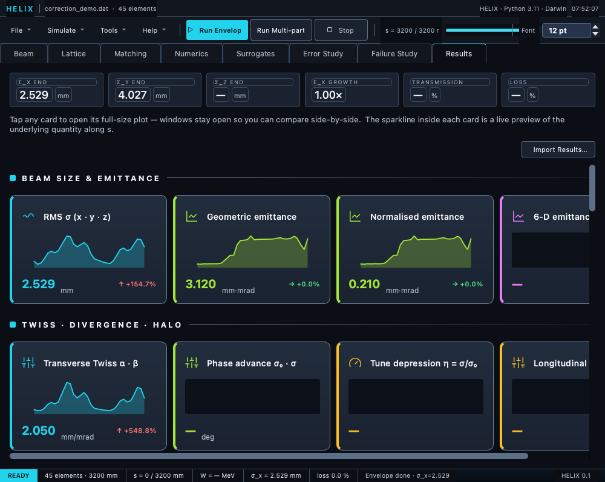

# Results tab

The Results tab is your post-tracking dashboard.  After a run,
diagnostic data is grouped into "tiles" (cards) by topic; click any
tile to open a popup with the full plot + numerical summaries.
Popups stay open side-by-side for comparison.

Nearly every tile carries a live **sparkline thumbnail** and an
**end-value + trend** footer.  Most read a recorded array directly;
the rest derive their series (cumulative phase advance, per-cell
tune depression and Hofmann ratio from the probe, dispersion and
σ(Δp/p) from the Σ-matrix, beam power, centroids) — and the
**LATTICE PARAMETERS** tiles read the loaded lattice itself, so they
render before any run and update when the lattice changes.  A tile
shows "—" only when its quantity genuinely doesn't exist yet: the
per-cell tune tiles need a probe-bearing run *and* a declared
periodic structure (an aperiodic whole line has no tune), the halo /
IBS / stripping tiles need a multi-particle H⁻ run, and the
phase-space / field-map / matrix / halo-action-scan tiles have no 1-D
curve to preview.
The footprint tile stays plain until you compute one in its popup.



*Results tab after an envelope run — KPI strip on top, tile sections with live sparklines below.*

## KPI strip

Across the top, six always-visible KPI cards summarise the latest
run at a glance: **σ_x end**, **σ_y end**, **σ_z end** (mm),
**ε_x growth**, **transmission** (%), and **loss** (%).  The growth is
that of the normalised emittance, end over start: the geometric one
shrinks with acceleration.  Through an RFQ it would read ×0.14 for a beam
whose normalised emittance grows ×1.17.  A value the run shown does not
have reads "—" (2026-10-25: an envelope run shown after a multiparticle
run used to keep the multiparticle run's transmission and loss).  For a
[ring run](#ring-runs) the six are σ_x, σ_y and σ_ζ (mm) on the last
statistics row, at the start of the ring; the growth of the normalised
betatron emittance in x (the dispersion's share removed) from the first
row to the last; and the survival (%) and the particles lost (%) — with
injection, of the particles the ring received.  The survival counts
macroparticles: with both a starting beam and injection, whose
macroparticles stand for different numbers of real particles, it is not the
fraction of real particles.

## Import Results…

The **Import Results…** button loads a previously saved run — a
HELIX-native `.h5` or an openPMD `.opmd.h5` (auto-detected) — and
feeds it through the same path a live simulation uses, so the KPI
cards, sparklines, and every popup re-populate from the on-disk
arrays.  The file dialog opens in the configured calculation
directory, where every run's auto-saved dumps land (see
[Running → GUI](../06_running/05_gui.md)).  A ring run's file
(`<time>_ring.h5`) is shown as the ring run ([Ring runs](#ring-runs));
it is refused while a Ring-tab run is going, whose results it would
replace.

## Searching the tiles

The search box at the left of the same row (2026-10) filters the tile
grid as you type: only the tiles whose label, section, unit or common
synonyms contain every typed word stay visible, packed from the left,
and a section with no match disappears.  Greek letters can be typed as
words ("sigma", "eta", "epsilon"), "H-" finds the H⁻ tiles, and a
small typo ("emitance") still finds emittance.  ++enter++ opens the
first visible tile, ++esc++ or the clear button restores the full grid,
and ++ctrl+f++ jumps to the box whenever the Results tab is current.
Hidden tiles keep updating in the background and stay available to the
assistant's *open plot* command.

## Tile sections

Eleven section headers, top to bottom (the RFQ section only for a
lattice with RFQ cells; RING RUN only while a ring run is shown, and then
at the top):

* **BEAM SIZE & EMITTANCE** — RMS σ (x · y · z), geometric
  emittance, normalised emittance, 6-D emittance.
* **TWISS · DIVERGENCE · HALO** — transverse Twiss α · β, phase
  advance σ₀ · σ, tune depression η = σ/σ₀, **BMAG along s** (2026-10:
  the mismatch factor BMAG = ½(β_b γ_d − 2 α_b α_d + γ_b β_d) of the
  run's own Twiss at every record against the design, per plane x, y,
  z; 1 = matched; the design is the error-free envelope of the current
  lattice and Beam-tab config, computed once in the background and
  shared with the phase-space ellipses; records with no design row
  within 0.5 mm and DC records in z are left blank; Raw uses the
  projected Twiss, Dispersion-corrected the betatron Twiss of the
  transverse planes), **Hofmann stability
  chart**, **tune footprint (frozen SC)**, longitudinal Twiss,
  divergence σ_x' · σ_y', peak excursion X / Y_max, halo parameter
  H_x · H_y, and the **halo action scan (n·ε_rms)** (see
  [below](#halo-action-scan)).  The phase-advance and tune-depression
  popups plot the
  **channel tunes** (σ_model, primary) with the beam Δμ_rms as a
  secondary series; the Hofmann and footprint tiles are the two
  space-charge diagnostics described below.
* **ENERGY · KINEMATICS** — energy · γ · transmission, beam power,
  4-D invariant ε_4D, eigenemittances ε₁ · ε₂ · ε₃, and **intrinsic ε
  (canonical, norm.)**.  The energy tile's number is the reference
  particle's kinetic energy at the end of the line, the energy the RF
  phases are referred to.  The beam's mean energy can differ from it:
  at the exit of the PXIE RFQ the bunch's mean is about 25 keV above
  the reference particle's 2.0985 MeV.  The tile's tooltip gives
  both, and the popup draws the mean (the reference plus the
  centroid's ΔW) dashed beside the reference curve wherever the two
  differ.  The last tile shows the 6-D intrinsic
  emittances in normalised canonical units against the projected
  ε_nx, ε_ny and ε_nz, plus the projected/intrinsic coupling ratios.
  These modes stay invariant through dispersion and RF coupling (see
  [Emittances](../09_diagnostics/02_emittances.md#normalised-canonical-intrinsic-emittances)).
* **LOSSES · TRANSMISSION** — loss profile, aperture-profile
  losses, **loss power (W/m · W/cm²)**, intra-beam stripping (H⁻),
  magnetic stripping (H⁻), and the error-study ensemble tile.
* **CENTROID · DISPERSION** — centroid ⟨x⟩ · ⟨y⟩ · ⟨φ⟩,
  longitudinal offset Δφ_s · ΔW_s, dispersion D_x · D_y, and
  **σ(Δp/p) along s** (the momentum-spread plot; see
  [σ(Δp/p) tile](#momentum-spread-tile) below).
  The dispersion popup plots the **statistical** dispersion of the
  tracked beam — `D_u = ⟨u·δ⟩/⟨δ²⟩` from the Σ-matrix cross terms,
  which includes space charge and any seeded input dispersion — and a
  **Transfer-matrix model** checkbox overlays (dashed) the dispersion
  of the lattice itself: the unit energy-offset ray propagated by the
  element transfer matrices, seeded from the Beam tab's input
  dispersion, computed in a background worker (field-map matrices are
  RK4-integrated on first use, so the first overlay on a long linac
  takes tens of seconds; later toggles are instant).  On a static,
  space-charge-free line the two curves coincide exactly — where they
  split, the difference is beam physics (space charge, nonlinearity),
  not machine optics.
  When the loaded lattice carries **diagnostic-matching targets**
  (`DIAG_POSITION` operands or a loaded BPM-targets file), the
  centroid popup overlays the **goal orbit** as hollow points at each
  BPM and a banner reports the achieved-vs-goal rms gap per plane —
  the direct "how close are we to what the diagnostics asked for"
  view.  Envelope results carry a real first moment too, so the same
  achieved-vs-goal banner appears for both tracking modes; only
  results from sources that genuinely carry no centroid (e.g. loaded
  archives) fall back to a note saying so.

Every popup carries a **live match preview** checkbox (top-right, off
by default).  Ticked, the popup re-plots the Matching tab's *current
iterate* about once per second while an optimization runs — watch the
orbit walk onto the goal points as the fit converges — and its title
shows `LIVE match iter N`.  When the match ends the popup snaps back to
the committed results.  Unticked popups ignore the stream entirely.
This is separate from end-of-run refresh, which is always on: every
visible popup updates whenever a normal run completes, regardless of
the checkbox.
* **PHASE SPACE · DIAGNOSTICS** — **Phase space (4-panel)** (the
  full phase-space view at any snapshot marker), density-vs-s
  heatmap, BPMs, field-map viewer (2D + cuts), cavity TTF T(β).
  The density-vs-s heatmap is drawn against the true s: recorded steps
  are unevenly spaced, so every column covers the same length of
  beamline and shows the average of the steps inside it, or the last
  step before it — it lines up with the ±σ and aperture overlays.

    The phase-space popup's **Beam parameters** toggle (2026-07) swaps
    the four density panels for a full parameter table of the
    *selected* distribution — location, species/mass/charge, beam
    current, reference particle (s, W_kin, β, γ, βγ, φ_s), centroid,
    RMS sizes (incl. derived σ_z and σ_δ), Twiss for **all three
    planes** (α_z/β_z in the internal (Δφ, ΔW) convention — α_z =
    −TraceWin's, β_z in deg/MeV), geometric / normalized / 4-D /
    eigen-emittances, Wangler halo, and per-coordinate max extents.
    The table follows the location selector, and ++ctrl+s++ exports it
    like any other popup data.

    The longitudinal panel shows Δφ and ΔW, the phase and energy of each
    particle relative to the reference particle.  The **basis** selector
    redraws it in TraceWin's (z, δ) instead: z = −Δφ·βλ/360 and
    δ = Δp/p = ΔW/(β²γ mc²), with β, γ and the RF wavelength λ of the
    reference particle at the plotted location (for the regenerated
    input beam, the Beam tab's energy).

    The **ellipses** checkbox (2026-10) overlays two ellipses on the
    x–x′, y–y′ and φ–W panels: the beam's own rms (Courant–Snyder)
    ellipse (solid) and the *design* ellipse (dashed) — the design α
    and β at that location drawn with the beam's rms emittance, so the
    two have the same area and differ only in shape and orientation.
    Both are centred on the beam centroid and use the projected Twiss
    (dispersion included), i.e. the same numbers as the Beam-parameters
    table.  Each panel title then shows the mismatch factor
    BMAG = ½(β_b γ_d − 2 α_b α_d + γ_b β_d), where 1 means matched (the
    conventional mismatch amplitude is BMAG + √(BMAG² − 1)).  The
    design comes from the Beam-tab input Twiss at s = 0 — also for
    envelope or loaded results, whose plotted beam is the regenerated
    input — and elsewhere from the error-free envelope of the current
    lattice and Beam-tab config, computed once in the background (the
    same companion run the tune-depression and Hofmann popups use; the
    title reads "BMAG …" until it is ready).  The title reads "BMAG
    n/a" when no design exists (no lattice loaded, a failed envelope,
    no envelope row at that s); a DC record gets no longitudinal
    ellipse, and a degenerate plane none at all.  The overlay follows
    the fold and location selectors, is redrawn in the (z, δ) basis
    with the same linear map as the particles (BMAG is basis-
    invariant), and ++ctrl+s++ exports the curves as "rms ellipse" /
    "design ellipse".  Each overlaid panel carries a small legend;
    clicking an entry hides that ellipse (without changing the view).
    The checkbox is off by default and remembered.

    The **profiles** checkbox (2026-10) adds each map's two projected
    distributions: the horizontal quantity's histogram in a strip
    below the map and the vertical quantity's in a strip to its left
    (counts grow away from the map), so a Gaussian beam shows a
    Gaussian on both sides.  Each profile sums the plotted particles
    over the other coordinate, with the same range and bins as the
    map, on a linear scale and scaled to its own peak (the map's
    colours stay logarithmic).  With **rms Gaussian** ticked, the
    Gaussian with the plotted particles' mean and rms is dashed over
    each profile, normalised the same way, so a peaked core or a flat
    top stands out.  The strips carry the axis titles and tick values,
    follow the map's zoom, and follow the basis, location, fold and
    colour selectors; ++ctrl+s++ exports their curves as
    "‹quantity› profile" and "rms Gaussian".  Both checkboxes are on
    by default and remembered; with profiles off the panels look as
    before.

    The popup plots the particles the run's statistics describe.  When
    the time-domain RFQ solver leaves particles out of the statistics
    (Numerics → **RFQ statistics: accelerated particles only**: those
    that fall behind the bunch and leave the RFQ unaccelerated), they
    are left out of the four panels, the profiles, the ellipses and
    the Beam-parameters table's statistics too, and the toolbar says
    how many ("3 unaccelerated particles not shown").  The table still
    counts them in its macroparticle and transmission rows, as the run
    does, and has a row "left out of the statistics".  Two MeV below
    the bunch, a handful of them would otherwise stretch the φ–W
    energy axis several times over.
* **LATTICE PARAMETERS** — per-element field/optics scalars read off the
  lattice itself; see [Lattice-parameter field plots](#lattice-params) below.
* **RFQ** — ten panels on the RFQ: vane geometry, cross-section,
  modulation and aperture, synchronous phase and energy, focusing and
  acceleration, surface field, fields along the axis, losses, bunching,
  and the cell table; see [RFQ panels](#rfq-panels) below.  Shown only
  when the lattice has `RFQ_CELL` elements.
* **CROSS-CHECKS · COMPARE** — compare with TraceWin partran
  output.
* **ADVANCED · MATRIX VIEWERS** — Σ matrix along s, transfer matrix
  (6×6), SC convergence.  The Σ card opens the
  [Σ matrix along s](#sigma-terms) popup, as does **Tools → Show
  Sigma Matrix…**.  The other two cards don't open popups of their
  own: the transfer-matrix card routes to the **Tools → Show Transfer
  Matrix…** dialog, and the SC-convergence card jumps to the
  [Numerics tab](04_convergence_tab.md), where the convergence
  scans live.
* **RING RUN** — what only a ring run has: its ramp, the bunch in eV·s,
  the losses along the ring, the tune diagram, phase space at the
  snapshot turns, the periodic optics and the injection; see
  [Ring runs](#ring-runs) below.

## Ring runs {#ring-runs}

With the results of a ring run — a run of the Ring tab, the assistant's
`run_ring`, or a `_ring.h5` file imported — a selector **Run shown:
Linac run | Ring run** appears beside **Import Results…** (2026-10-25).  A
new ring run is shown when it ends (with ring mode on; a ring results file
imported is shown in any case), a new linac run likewise, and the selector
switches between the two at any time: neither run is changed, the project
is not marked as changed, and each window keeps the zoom it had on each
run.  The status bar and **Export
openPMD output…** keep following the linac run.  The Ring tab's **Show in
the Results tab** button opens this tab on the ring run, and so does the
assistant's *open plot* for a RING RUN tile.

While the ring run is shown:

* A line above the tiles says what they show: the beam turn after turn at
  the start of the ring (s = 0), on every turn (every k turns for runs of
  more than 100 000 turns).
* **The beam's tiles show it turn by turn**: RMS size, the emittances
  (geometric, normalised, 6-D, 4-D, eigen- and canonical), Twiss,
  longitudinal Twiss, divergence, energy, transmission (the survival),
  centroid, longitudinal offset, dispersion, σ(Δp/p) and the Σ matrix.
  Their horizontal axis is the turn, without a lattice strip (the
  **Show lattice**, **Show aperture** and **live match preview** boxes are
  hidden), and their quantities and units are the linac run's: each
  statistics row's mean
  and covariance, in the ring's coordinates (x, px = Px/P0, y, py, ζ, δ),
  are carried into x′ = px/pz with pz = √((1+δ)² − px² − py²),
  Δφ = −360° f ζ/(β0 c) and ΔW, to first order about the row's mean, at
  the RF frequency f of the first turn (the revolution frequency without
  RF).  The dispersion is D = ⟨u δ⟩/⟨δ²⟩ of the bunch, the dispersion
  window's transfer-matrix model is off and its box hidden (the ring's
  periodic dispersion is in **Ring optics**), and the centroid window draws no
  BPM goals.  Switching back to the linac run brings its axes, strips
  and boxes back as they were.
* **Tiles that do not apply are dimmed** — the largest excursion and
  the halo parameter (not recorded turn by turn), BPM readings, a linac
  channel's phase advance, tune depression, BMAG, Hofmann chart and
  frozen footprint, the LEBT compensation (SCC) and the halo action scan
  (linac runs only), beam power, the aperture-loss and loss-power
  profiles, the H⁻ stripping tiles, the error ensemble, the phase-space
  window, the density along s, transit-time factors and the comparison
  with a linac code's output, and the RFQ panels.  Each tooltip says why,
  and where in RING RUN the ring's counterpart is.  Their windows close
  when the ring run is shown.
* **The lattice tiles** (gradients, RF voltages, fields, …) show the
  loaded lattice as always; the bend tiles' field uses the ring run's
  rigidity at its first statistics row (the start of a ramp).
* **RING RUN**, at the top, adds what only a ring run has:
    * **Ring ramp** — the reference's kinetic energy, the synchronous
      phase (of the net voltage), the RF voltage and frequency turn by
      turn, the transition turn marked;
    * **Ring bunch** — the rms longitudinal emittance (eV·s), the bunch
      length σ_ζ (m) and σ_t = σ_ζ/(β0 c) (ns), the relative momentum
      spread σ_δ, and with space charge the line-density bins the run
      used;
    * **Ring losses** — the particles lost along the ring (with the
      lattice strip) and in each turn, and the elements where most were
      lost;
    * **Ring tunes** — the tune diagram: the probes' NAFF tunes, the bare
      working point (+), with space charge the analytic tune shift at the
      bunch centre (×, when it is within half an integer), the resonance
      lines m Qx + n Qy = p up to the fourth order, framed on the points;
      and the tunes as text;
    * **Ring phase space** — at each snapshot turn, x–px, y–py and ζ–δ as
      density maps of all the particles (or as dots), each with its two
      profiles and their rms Gaussians, the separatrix of that turn's RF
      bucket on ζ–δ, and the line density along the bunch in the run's
      own line-density bins, with the Gaussian of the same rms;
    * **Ring optics** — the run's periodic β_x, β_y and D_x at every
      element's exit (at the start of a ramp), with the 4-D and 6-D
      tunes, the chromaticities, the momentum compaction, γ_t and the
      synchrotron tune (a file written before 2026-10-25 carries no
      optics table);
    * **Ring injection** — the macroparticles injected, the waste and the
      circulating beam's foil crossings in each turn, drawn at the turn
      counted from 1 (where the circulating count rises), the particles
      circulating, the closed orbit at the foil with each turn's magnets,
      and the foil's hit map.

    A RING RUN tile is dimmed, with the reason, when the run has none of
    its data: no ramp, no particle lost, no tune probe, no snapshot turn,
    no foil.

## Raw vs Dispersion-corrected toggle {#raw-vs-dispersion-corrected}

Seven popups expose a **Display** dropdown at the top with two
options:

* **Raw (includes dispersion)** — the σ-matrix entry as recorded.
  In dispersive regions (arcs, RF-coupled sections, solenoid HWR /
  SSR cryomodules with non-zero Σ[i,5] cross terms) this includes
  the dispersive contribution `D · σ_δ`.
* **Dispersion-corrected (betatron only)** — the pure-betatron
  part, obtained by subtracting the Schur complement on the
  σ-matrix energy block:

  ```text
  Σ_β,ii = Σ_ii − Σ_i5² / Σ_55
  Σ_β,ij = Σ_ij − Σ_i5 · Σ_j5 / Σ_55
  ```

  From these, σ_x,β = √Σ_β,(0,0), ε_x,β = √(Σ_β,(0,0)·Σ_β,(1,1) − Σ_β,(0,1)²),
  α_x,β = −Σ_β,(0,1)/ε_x,β, β_x,β = Σ_β,(0,0)/ε_x,β.

**Which popups carry the toggle**:

| Popup | Raw display | Dispersion-corrected display |
|---|---|---|
| RMS σ (σ_x, σ_y) | recorded `sigma_x`, `sigma_y` | √Σ_β,(0,0), √Σ_β,(2,2)  (σ_φ stays raw — already in the energy plane) |
| Emittance (ε_x, ε_y, ε_t 4-D) | recorded `emit_x`, `emit_y`, `emit_4d` | √det(Σ_β,2×2) per plane, √det(Σ_β,4×4) for 4-D  (ε_z stays raw) |
| Normalised emittance | `emit_nx`, `emit_ny` | ε_β · (βγ) per plane |
| Twiss (α, β) | `alpha_x`, `beta_x`, `alpha_y`, `beta_y` | α_β, β_β from Σ_β,2×2 |
| Divergence (σ_x', σ_y') | √Σ_11, √Σ_33 | √Σ_β,(1,1), √Σ_β,(3,3) |
| Peak excursion (X_max, Y_max) | particle-tracked x_max / fallback 5·σ_x | fallback path uses 5·σ_β; MP-tracked x_max is the raw truth in both modes |
| Halo action scan (x–x′, y–y′) | counts in the tracked (u, u′) plane | counts in the betatron plane u − (Σ_u5/Σ_55)·δW, u′ − (Σ_u′5/Σ_55)·δW, whose ε is √det(Σ_β,2×2); **the default here** (φ–W has no toggle) |

**When to use each**:

* **Raw** for aperture / loss studies — what actually hits the wall.
* **Dispersion-corrected** for matching diagnostics — the design β·ε
  comparison only holds for the pure-betatron part.  In any
  dispersive section the raw σ disagrees with the design β by the
  dispersion-induced inflation; the corrected view removes it so the
  measured optics matches the design intent.

**Edge case — DC beam / zero energy spread**: when Σ[5,5] ≤ ε, the
dispersive contribution is zero by construction, so the helper
returns the raw entries unchanged.  No NaN, no zero-division.

**Cross-references**:

* [`σ(Δp/p) tile`](#momentum-spread-tile) — the related plot of the
  beam's momentum spread along s; the same σ_W and reference
  β, γ that go into the σ(Δp/p) tile drive the Schur-complement
  correction here.
* [Dispersion (D_x · D_y) popup](#) — explicit dispersion functions;
  the disp-corrected σ_x and Dispersion together let you read off
  the dispersive contribution σ_x² − σ_x,β² = D_x²·σ_δ² for
  internal-consistency checks.

## σ(Δp/p) tile — RMS momentum spread along s {#momentum-spread-tile}

Computed from the recorded RMS energy spread `σ_W(s)` and the
reference particle's β, γ:

```
σ(Δp/p) = σ_W / (β² · γ · m₀c²)
```

This is the inverse of the conversion the **Dispersion D_x/D_y**
tile applies internally, so the two are mathematically consistent.

**Typical values** for a proton beam in the PIP-II energy range
(σ_W ≈ 10 keV at 2-10 MeV): σ(Δp/p) of order **10⁻³ to 10⁻⁴**.

**What to look for**:

* **Adiabatic damping through accelerating sections**: as the beam
  picks up energy, β²γ·m₀c² grows, so σ(Δp/p) *shrinks* even
  though σ_W stays roughly constant.  A jump in σ(Δp/p) at a
  cavity boundary indicates real longitudinal mismatch (not just
  acceleration).
* **Longitudinal acceptance** for downstream RF buckets — the
  acceptance is usually quoted in dp/p, not σ_W; this plot lets
  you read it off directly.
* **Dispersion-driven beam size**: in arcs (BTL), σ_x picks up a
  contribution `D_x · σ(Δp/p)`; reading both off their respective
  tiles tells you whether dispersion or betatron motion dominates.

**Source**: `_DpPRmsPopup` in `gui/linac_gen_gui/interphase/tabs/results_tab.py`
(uses the same `sigma_w` / `ref_beta` / `ref_gamma` / `mass_mev`
fields as the Dispersion popup, with the same fallback for
`mass_mev` when it's not in the results).

## Σ matrix along s {#sigma-terms}

Every row of a run records the beam's 6×6 second-moment matrix Σ, in the
order (x, x′, y, y′, Δφ, ΔW) with x, y in mm, x′, y′ in mrad, Δφ in
degrees of the local RF and ΔW in MeV.
- **Multiparticle run:** the centred covariance (1/N) of the particles
  the statistics describe. Lost particles, and the time-domain RFQ's
  unaccelerated ones, are left out.
- **Envelope run:** the propagated matrix, including the coupling of
  solenoids and field maps.

Σ is symmetric, so 21 of its 36 entries are independent. The popup plots
all 21 along s, in the matrix's own layout (its lower triangle):

* **Diagonal panels:** the rms values σᵢ = √Σᵢᵢ: σx, σx′, σy, σy′, σΔφ and
  σΔW (in keV).
* **Below the diagonal:** the correlations r_ij = Σ_ij / √(Σᵢᵢ Σⱼⱼ), each
  between −1 and 1 on a fixed −1…1 frame. With **Quantity → covariance**,
  these panels show Σ_ij instead, in the units of its row times its
  column (mm·mrad, mm·deg, …).
* **Colours:** the terms within one plane take the plane's colour (x
  cyan, y green, z amber). The 12 terms between two planes share one
  colour, so coupling stands out. A solenoid shows up as strong x–y′
  and x′–y correlations inside its field (the beam rotates).

**Inside elements.** A run records a row at every element exit. The terms
inside a solenoid or field map show only with **Numerics → Record
per-sub-step** on, which adds rows inside the elements; the popup says so
when a run has element-exit rows only.

As a check, HELIX and TraceWin agree for the PXIE LEBT, run from the same
100 000 particles with the same solenoid settings, at TraceWin's output
positions:
- r(x, y′) and r(x′, y) reach ±0.999 inside the third solenoid in both
  codes (TraceWin +0.9994, HELIX +0.9993), with the same signs everywhere.
- The two codes differ by at most 0.03 in r. Where |r| > 0.5, Σ differs by
  3 % on average.
- x–y and x′–y′ stay within ±0.01 in both codes.

**Position.** The slider, or a click on any panel, picks a recorded row.
A cursor marks it in every panel, and the right-hand side shows at that
position:
- the whole correlation matrix as colours with the numbers written in;
- Σ itself, in the units of its row and column;
- for each plane, the rms values, the rms emittance, α and β.

Hovering reads the value under the mouse. A double-click enlarges a panel
to the full width, with the lattice strip.

**Basis.** **(x, x′, y, y′, z, δ) — TraceWin** converts each row with that
row's reference particle and RF frequency: z = −βλ·Δφ/360 (in mm) and
δ = ΔW/(β²γ·mc²) (in ‰). Because each row is converted on its own, z and
its moments do not jump at a frequency change, while Δφ, counted in
degrees of the local RF, does (σΔφ doubles at a 162.5 → 325 MHz jump). The
correlations are the same in both bases, except that those with z have
the opposite sign of those with Δφ, since z = −k·Δφ. The z plane's
emittance then comes out in mm·mrad (δ in ‰ = mrad), as in TraceWin, and
the (Δφ, ΔW) plane's in deg·MeV.

**Gaps, not zeros.** A term that is not defined is not drawn:
- the phase terms where the beam is continuous (no bunch), with a note
  saying where;
- correlations with a zero variance, such as a beam without energy
  spread;
- every term of a row that has no particles left.

An envelope run of a beam injected continuously with zero energy spread
seeds a longitudinal block with no area at the first RF element. That
beam has r(Δφ, ΔW) = ±1 and zero longitudinal emittance, which is the
model's answer, not a display fault.

The tile's sparkline is the largest |r| between two planes along s: 0
means uncoupled, 1 fully coupled. Its tooltip gives where that largest
value occurs.

**Source**: `linac_gen/analysis/sigma_terms.py` (the 21 terms, the basis
conversion, the plane summary: pure functions, usable from scripts) and
`gui/linac_gen_gui/interphase/tabs/sigma_popup.py` (the popup).

## Space-charge diagnostics — Hofmann chart & tune footprint {#sc-diagnostics}

Two tiles in **TWISS · DIVERGENCE · HALO** open the space-charge
diagnostics built on the channel tunes (full theory:
[Hofmann stability & tune footprint](../09_diagnostics/07_hofmann_footprint.md)):

* **Hofmann stability chart** — opens with the exact per-cell
  (k_z/k_x, k_x/k_0x) trajectory (instant, from the pre-computed
  phase-probe maps).  **Compute chart** then solves the corrected
  anisotropic l=2/3/4 KV dispersion relations off-thread and renders the
  γ/ν₀ₓ growth-rate heatmap at the trajectory's median ε_z/ε_x, with each
  cell classified: green = valid + stable, red = flagged
  (γ/ν₀ₓ > 0.01 inside the S² ≤ 10 gate), grey hollow = extrapolated
  (S² > 10), amber ring = fold risk.  Optional toggles add per-cell
  Monte-Carlo `P(unstable)` and the *indicative* legacy m/n bands.

* **LEBT compensation (SCC)** — for **DC/continuous** results only:
  choose gas and pressure (log slider 10⁻⁷–10⁻⁴ mbar), solver mode
  (Computed Poisson–Boltzmann balance / Assumed η), trapped-ion
  temperature, end taper and build-up time, then **Compute** for
  f_c(z), φ(z), τ_scc(z) and gas-survival profiles — plus suggested
  `SPACE_CHARGE_COMP` factors with **Export cards** and a confirm-gated
  **Apply to lattice…** (full theory:
  [LEBT compensation](../05_space_charge/07_lebt_scc.md)).
* **Tune footprint (frozen SC)** — press **Compute footprint** to re-track
  the selected cell **off-thread** with a frozen matched-beam field; the
  scatter shows each particle's (μ_x, μ_y) coloured by launch amplitude,
  with the core tune and spread in the caption.

For **multi-particle results** (no probe maps), the tune-depression popup
offers a **Compute channel model** button — a companion envelope probe at
the current Beam-tab config that fills the model curves next to the MP
beam markers; the Hofmann chart reuses the same cached probe.

## Halo action scan {#halo-action-scan}

The **Halo action scan (n·ε_rms)** tile shows, for one plane at a time,
how much of the beam lies outside the ellipses of its own rms shape
whose emittance is n times the local rms emittance — n = 1 is the rms
ellipse, and a particle at n reaches √n rms sizes (definition and
reference values: [Halo analysis → Action
scan](../09_diagnostics/03_halo.md#action-scan)).  It needs a
multi-particle run made with **Record halo action scan** ticked on the
Numerics tab (or a results file written by such a run); otherwise the
window says what is missing.

Controls: **plane** (x–x′, y–y′, φ–W), the **Display** toggle
(dispersion-corrected by default, x and y only), **n max** (top of the
n axis; *auto* = 1.1 × the 95th percentile of the outermost particle's
n along the line, at least 20) and **lattice** (element strip).

The **Map** tab:

* **Map** — s horizontally, n vertically, colour = % of the particles
  present at that s outside the ellipse (log scale, 100 % down to one
  particle; empty cells are transparent).  The map is drawn on an even
  s grid: a column that covers recorded steps shows the largest value
  among them, and a column between two records holds the last step
  recorded before it.  Solid lines mark where 1 %, 0.1 % and 0.01 % of the beam
  remain (a level is drawn only where it is at least one particle),
  dashed lines the same levels for a Gaussian beam (n = 9.21, 13.82,
  18.42), and the dotted line the outermost particle.  Hovering reads
  the exact count at the recorded step at or before the cursor and at
  the grid value of n at or below it: s, element, % and number of
  particles outside, the local ε_rms,n and the ellipse emittance
  n·ε_rms,n.  Clicking moves the position.
* **ε_n** — the normalized rms emittance of the plane along s (the
  unit of the n axis at every position).
* **position** slider (by recorded step), then the **slice**: % outside
  vs n at that position with the Gaussian 100·e^(−n/2), and a readout
  (particles present, ε_rms normalized and geometric, outermost n, the
  n of each level against its Gaussian value).

The **3D** tab draws the same data as a surface (n, s, % outside);
drag to rotate.  **Ctrl+S** exports the plotted curves and, in addition,
the exact recorded counts and % outside of the plane on display
(rows = steps, columns = grid values) with the grid, ε, ε_n, n_max and
n_alive.

## Lattice-parameter field plots {#lattice-params}

The **LATTICE PARAMETERS** section plots a single scalar per element, read
from the **lattice** (design values) rather than the tracked beam — one stem at
each element's mid-point. Each shows a centred "no data" message when the
lattice has no element of that type.

| Tile | Quantity | Elements | Units |
|---|---|---|---|
| Quadrupole gradient | `G` | quads | T/m |
| Quadrupole ∫G·ds | `G·L` | quads | T |
| RF voltage (V₀) | `\|ke\|·∫\|E_z\|dz/\|norm\|` (or lumped `voltage`; the inter-vane voltage for RFQ cells) | RF gaps, cavity field maps, RFQ cells | MV |
| Peak E_acc | peak axial accelerating gradient | cavity field maps | MV/m |
| Peak solenoid \|B_z\| | on-axis peak field | solenoids, magnetic field maps | T |
| **Solenoid ∫B²·dz** | **integrated B_z² — focusing strength** | **solenoids, magnetic field maps** | **T²·m** |
| Dipole field \|B\| | `Bρ/\|ρ\|` (hard-edge) | dipoles (`BEND`) | T |
| Dipole ∫B·dl | `B·L = Bρ·θ` | dipoles (`BEND`) | T·m |
| Floor plan (survey) | design-trajectory geometry | whole lattice | m |
| Synchronous phase | `φ_s` | RF / field-map elements, RFQ cells | deg |

**∫B²·dz** is the energy-independent measure of a solenoid's transverse
focusing strength: the solenoid focusing parameter is
`(1/2Bρ)²·∫B_z²·dz`, so this integral captures the lens shape independent of
beam energy. It is computed for both solenoid representations — a lumped
`SOLENOID` (hard-edge uniform field → `B₀²·L`) and a magnetic field map
(trapezoidal integral of the on-axis `B_z(z)²` profile, scaled by
`kb·scale/norm`). RF cavities (field maps with an E channel) are excluded.

1-D and 3-D field maps are both covered, and so are maps inside a
`SUPERPOSE_MAP` cluster (the PIP-II HWR/SSR solenoids carry two
superposed correctors).  A cluster is one stem whose value comes from
the **summed** on-axis field of its children, each placed at its
position in the cluster with its own `k·scale/norm`: the solenoid tiles
use the static-magnetic children, the RF voltage and E_acc tiles the
electric ones, added as phasors with each card's RF phase (so cavities
180° apart cancel).  Only the span the cluster tracks counts (a map
placed at a negative position contributes from the entrance on).
Children at zero amplitude add nothing, so a solenoid with unpowered
correctors shows exactly the solenoid's own value, and ∫B²·dz changes
smoothly as a corrector is powered.  As for plain maps, the samples are
spread over each card's length and the error-study amplitude factors
are not applied — the tiles show the deck's design values.

The **dipole tiles** are the one lattice-parameter pair that needs the beam:
a `BEND` card stores only geometry (bend angle `θ` and curvature radius
`ρ`), so the field is `B = Bρ/|ρ|` at the **beam rigidity**. After a run
the rigidity is taken per element from the run's reference energy (exact
through accelerating sections); before any run it uses the beam-config
entrance energy — exact for fixed-energy transfer lines. Without a beam
configuration the tiles show the placeholder rather than a guess. Since
`θ` is fixed by the card, `∫B·dl = Bρ·θ` — the field-integral tile is the
design invariant that stays constant when a dipole is shortened at fixed
bend angle.

**Floor plan (survey)** walks the reference orbit through the lattice in
3-D and draws the design trajectory: a top view (`x`–`z`, aspect-locked,
horizontal dipole arcs highlighted) and a side view (`y` vs path length
`s`, vertical dipole arcs highlighted), with entrance/exit markers and a
summary line (path length, Σ|θ|, dipole counts, exit coordinates). Pure
lattice geometry — no run required; a straight lattice draws a straight
line. Sign conventions: positive horizontal bend angle curves toward
`+x`, positive vertical angle (`hv=1`) toward `+y`; MAD-style negative
drifts step backward.

## RFQ panels {#rfq-panels}

The **RFQ** section appears when the loaded lattice contains `RFQ_CELL`
elements and hides again for a lattice without them (the tile search
follows the same rule).  The design panels draw from the loaded lattice
before any run.  After a multiparticle run, the panels add the run's
values at every cell exit when the results belong to the loaded lattice,
matched by cell name; otherwise they show the design alone and say so.
A results file read back with **Import Results…** works the same way:
the cell parameters come from the loaded lattice, the beam values from
the file.  Editing a cell in the lattice redraws the open panels.  With
several RFQ cell chains in the lattice, the panels show the first.

**The vanes.**  The panels draw the vanes the time-domain solver uses:
those of the deck's `RFQ_GEOM` vane file (with the file's own pole
numbering, pole 1 = +y), or, without one, the vanes built from the
`RFQ_CELL` cards (the two-term tip condition, the flare law in the ±3
cells, the `RFQ_GAP_RMS_FFS` gaps).  When the solver cannot use the
vanes — a vane file that cannot be read, several vane voltages, several
cell chains — the panels draw the cards' vanes and give the reason.

**Nothing is built for a plot.**  A panel never solves a field map or a
vane profile.  The surface-field panel and the 3-D fields use the
time-domain solver's field map of these vanes only when it is already
cached (the first time-domain run builds it), and the vane-field profile
is read from the per-cell model's cache file.

| Tile | What it shows |
|---|---|
| RFQ vane geometry | Top (x) and side (y) views along s: the ±x and ±y vane tips and r0 per cell; with a vane file, the tips the cards describe as a dashed grey line for comparison; after a run, the beam's largest \|x\|, \|y\| and ±3σ at each cell exit. |
| RFQ vane cross-section | The four electrodes in a transverse cut at any z, chosen with the slider or the cell box: the metal in grey, the smallest tip distance at that z (dashed circle) and r0 (dotted); the line below gives the four tip distances and the tip radius. |
| RFQ modulation & aperture | Per cell from the cards: modulation m; r0, the smallest tip distance a and the widest m·a; the cell length L, with βλ/2 of the run's reference particle after a run (synchronism: L = βλ/2). |
| RFQ synchronous phase & energy | φ_s of the cards and φ_s implied by the cell lengths; the reference energy (design from β = 2L/λ, or the run's reference particle) and the beam's mean energy; the beam's mean phase and energy minus the reference's at each cell exit. |
| RFQ focusing & acceleration | A10 of the cards and A10 from (r0, m, L); RF defocusing Δ_rf; the zero-current phase advances σ0t and σ0l per βλ; the transverse and longitudinal current limits, with the beam current drawn across; the focusing strength B in the note. |
| RFQ surface field (Kilpatrick) | The peak surface field on the ±x and ±y vane tips along s, the Kilpatrick limit at the RF frequency, and their ratio. |
| RFQ fields along the axis | E_z on the axis and the quadrupole gradient ∂E_x/∂x at the RF crest: the time-domain field map when it is cached (solid) and the cards' two-term field; with a vane file whose per-cell profile is cached, the vane-field profile g_x, g_y of the per-cell model. |
| RFQ losses | Macroparticles lost per cell, the energy at loss against s, the lost power per cell, and where in x–y each particle was lost. |
| RFQ bunching & transmission | Transmission, σ_φ (with \|φ_s\|) and σ_W at each cell exit; when the run ends at the RFQ exit (or after at most 100 mm of drift), the exit longitudinal phase space. |
| RFQ cell table | One row per cell: name, type, s, L, V, r0, m, a, A10, φ_s from the cards and from the lengths, β, W_ref, E0T, B, Δ_rf, σ0t, σ0l, the current limits, and after a run the transmission, losses, σ_x, σ_y and σ_φ at the cell exit.  The header says which solver tracked the RFQ and why, with the time-domain run's statistics. |

The plots along the RFQ can be drawn against the cell number instead of
s (the **x: cell number** box; cell k is centred on k, and s maps
linearly through each cell).  ++ctrl+s++ exports any panel's data, the
cell table included.

### Formulas

The design quantities use the smooth approximation of the two-term
potential in HELIX's convention (A01 = 1),

  U = V/2 · [(y² − x²)/r0² ∓ A10·I0(kr)·cos kz],  k = π/L,

with V the inter-vane voltage of the cards, q the charge state, m c² the
rest energy, λ the RF wavelength, and β, γ of the reference particle:

| Quantity | Formula |
|---|---|
| energy gain per cell | ΔW = q·(π/4)·A10·V·cos φ_s, i.e. E0T = π·A10·V/(2βλ) |
| focusing strength | B = q·V·λ²/(m c²·r0²) |
| RF defocusing | Δ_rf = π²·q·A10·V·sin φ_s/(2 m c² β² γ) (negative below the crest) |
| transverse phase advance per βλ | σ0t² = B²/(8π²) + Δ_rf |
| longitudinal phase advance per βλ | σ0l² = π²·q·A10·V·\|sin φ_s\|/(m c² β² γ³) |
| transverse current limit | I_t = 8π·(m c²/q)·γ³·a²·b·σ0t²/(3 Z0 λ³ (1 − f)) |
| longitudinal current limit | I_l = 4π·(m c²/q)·γ³·a²·b·σ0l²/(3 Z0 λ³ f) |

The current limits are those of a uniformly charged ellipsoidal bunch,
one per RF period, whose transverse semi-axis is the cell's smallest
aperture a and whose half-length b = βλ·1.5\|φ_s\|/(2π) fills the
separatrix; f is the form factor of that spheroid (axis ratio p = γb/a;
f = 1/3 for a sphere), Z0 the impedance of free space.  They are the
currents at which the linear space-charge force of that bunch cancels
the zero-current focusing.  β is the run's reference particle at each
cell exit when the run belongs to the lattice; before a run it is the
design β = 2L/λ of the accelerating cells (types ±2), and Δ_rf, σ0 and
the current limits are left blank for the other cells.  The demo RFQ
gives B = 5.68.

φ_s from the cell lengths takes β = 2L/λ of consecutive cells as the
design energy gain and solves ΔW = q·(π/4)·A10·V·cos φ_s for φ_s (below
the crest); A10 from (r0, m, L) is the Crandall–Wangler two-term
relation (the [RFQ cell](../03_elements/09_rfqcell.md) page has both).

### The surface field

The tip of each pole is a circular arc of radius ρ.  At each z the
panel evaluates |E| of the time-domain field map on arcs at 3 and 5 map
steps from the tip surface, on the side facing the bore and the
neighbouring pole, extrapolates to the surface with the fall-off of a
curved conductor, E(δ) = E_s·ρ_e/(ρ_e + δ), fitted to the two samples,
and takes the largest value on the arc.  The field is at the RF crest,
scaled to the cards' voltage.  On a plain quadrupole (ρ/r0 = 0.75) the
estimate gives E_s = 1.24 V/r0 at the map's 0.1 mm step, within 1 % of
a solve on a twice finer grid; for r0 = 5.576 mm at 60 kV that is
13.3 MV/m, against 13.4 MV/m from a CST/SUPERFISH design study of that
cross-section (G. Romanov et al., *Project X RFQ EM design*, IPAC2012,
THPPP064).  The estimate assumes a tip that is
straight along z, so it is left out where a tip's slope |dR/dz| exceeds
0.35 within ±3 mm: the flares, the vane ends and steps between
neighbouring cells.  Field enhancement at sharp corners of the real
vanes (vane ends, undercuts) is not in a 0.1 mm map.

The Kilpatrick limit E_K is the root of f = 1.643·E_K²·exp(−8.5/E_K)
(f in MHz, E_K in MV/m): 13.6 MV/m at 162.5 MHz, 18.4 MV/m at
352.21 MHz.  The second plot is the peak of the two planes divided by
E_K (the bravery factor).

### Fields, losses and bunching

The cards' two-term field takes each cell at its own voltage.  It is
defined cell by cell, so it jumps at a cell boundary where neighbouring
cards do not match; when the time-domain map is shown, the plot is
framed on it.  Mid-cell, where the A10 term's gradient (∝ cos kz)
vanishes, the gradient is the quadrupole term's V/r0².

The lost power of a cell is Σ E_loss·I_avg/N, the energy of each
macroparticle at its loss times the average current per macroparticle
(the convention of the loss-power tile, with the Beam-tab current and
duty cycle).  Where a particle counts as lost depends on the solver: the
time-domain solver records the point where it touched the metal or left
the stored field region between the vanes, the per-cell model the point
where it left the cell's vane-tip boundary.

The exit phase space folds φ into one RF period about the bunch, as the
Phase Space plot does (a view only); a run made with
[periodic phase coordinates](03_beam_tab.md#periodic-phase-bunch-train)
is drawn as it is.

**Loss and envelope plots.**  Through the RFQ, the aperture drawn in
the loss and envelope plots is the cards' vane-tip distance, x and y
separately (display only: RFQ cells carry no aperture of their own, and
their losses come from their solver).

## Popup details

Each tile popup shows:

* The plot (zoomable, toggle log/linear).  Clicking an entry in the
  legend hides or shows that curve, and the view then refits the
  curves that remain (both axes, or only the vertical one when the
  horizontal axis is shared with other panels or the lattice strip);
  this also ends any manual zoom.  ++ctrl+s++ still exports hidden
  curves.
* **Auto-scaling.**  Every plot fits all its data, on both axes,
  whenever it is drawn anew: when its popup opens, when a new run's
  results arrive, when a live match preview ends on the committed
  result, and when a selector above the plot picks another quantity,
  element, plane or range.  A plot with no data yet is framed on the
  whole lattice.  A zoom (mouse wheel or drag) lasts until the next new
  plot: live updates (the match preview itself, a click on the card of
  a popup that is already open) leave it, although a few plots refit
  their vertical axis whenever they redraw (the beam-density plots, the
  halo-scan emittance strip, the σ plots after a lattice edit).
  **View All** in the right-click menu, the small **A** button in the
  plot's corner and the axis menu's **Auto** option switch
  auto-scaling back on, and it stays on; on a lower panel they act on
  the horizontal axis it shares with the panel above.  Charts with a
  designed frame keep it: the Hofmann and tune-depression charts, the
  halo-scan map and slice, the transmission panel (0–100 %), SCC
  f_c (0–1) and the correlation panels of the Σ matrix (−1 to 1).  View All fits a designed axis once (the other axis keeps
  fitting), and the next new plot restores the frame.  The plots in the
  other tabs and dialogs follow the same rule: a new study, parameter
  scan, failure study, convergence scan, calibration, campaign or
  multi-bunch result is a new plot, while the points of a study or scan
  in progress keep a zoom; the bunch-pattern strip and the ORM trim
  response keep their frames.
* An optional **lattice-element strip** along the s-axis — a
  colour-coded impression of the lattice, toggled by a checkbox and
  drawn without obscuring the curves.
* A numerical summary at top (means, ranges, percentile values).

**Saving from a popup**: press **Ctrl+S** or right-click for the
context menu ("Save plot…  (Ctrl+S)") — there are no dedicated save
buttons.  One dialog covers both data and image exports: pick a
data format (**CSV / NumPy .npz / JSON / HDF5**) to write the
plotted arrays, or an image format (PNG / JPEG / SVG / PDF) for the
figure itself.  **Ctrl+W** or **Esc** closes the popup.

## Tile availability

Every card is always present (the search box only hides the ones that
do not match the typed words), except the RFQ section, which shows only
for a lattice with RFQ cells, and RING RUN, which shows only while a
ring run is shown (when the tiles that do not apply to a ring run are
dimmed, each with its reason — see [Ring runs](#ring-runs)); cards
whose data is missing simply open an empty/"no data" view.  The one
exception is **Intra-beam stripping (H⁻)**: the card is disabled
unless the beam species is H⁻, and its tooltip explains how to
switch (Beam tab → Species → H- → Apply).  **Loss power** needs a
multi-particle run (envelope mode records no per-particle losses)
and a non-zero beam current — it says so in place rather than
drawing an empty plot, and its exit-plane W/cm² map additionally
needs the final distribution, so it fills on live MP runs while a
reloaded file keeps the W/m profile.  Eigenemittances are
always recorded — there is no flag to enable them.  The error-study
ensemble popup fills only after an Error Study run, the
phase-space popup needs snapshot markers (or Numerics → "Snapshot
every N") to have data, and the halo action scan needs Numerics →
"Record halo action scan" and a multi-particle run (it says so in
place; openPMD files written before 2026-09-27 do not carry it).  The
Σ matrix along s needs results that record Σ: results files written
before 2026-09-27, Sacherer envelope runs and bunch-train files have
none, and the popup says so in place.

## Exporting to openPMD

The toolbar's **Export openPMD output…** action writes the most
recent linac run to an openPMD-1.1 HDF5 file (`*.opmd.h5`) — a portable
interchange format readable by openPMD-aware tools.  (A ring run is
written by the run itself, as `<time>_ring.h5`.)  See
[Reading results → openPMD](../06_running/04_results.md#openpmd-interchange-format).

## Cross-references

* [Recorder fields](../09_diagnostics/01_recorder.md)
* [Reading results](../06_running/04_results.md)

← [Failure Study tab](06c_failures_tab.md) ·
[Continue to Workflows →](08_workflows.md)
